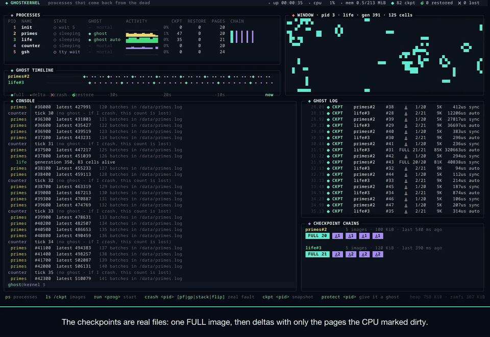
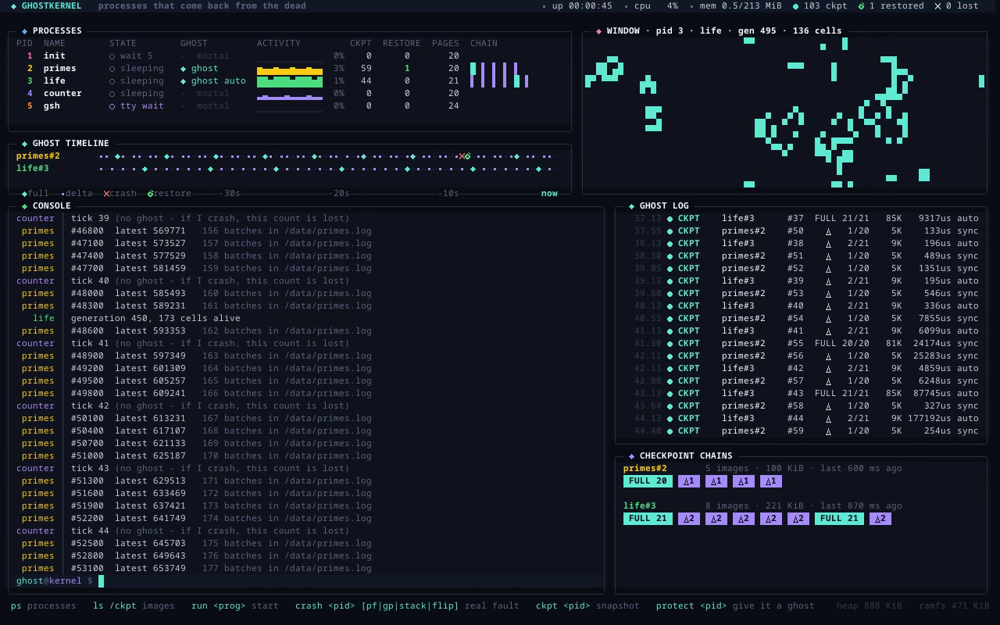
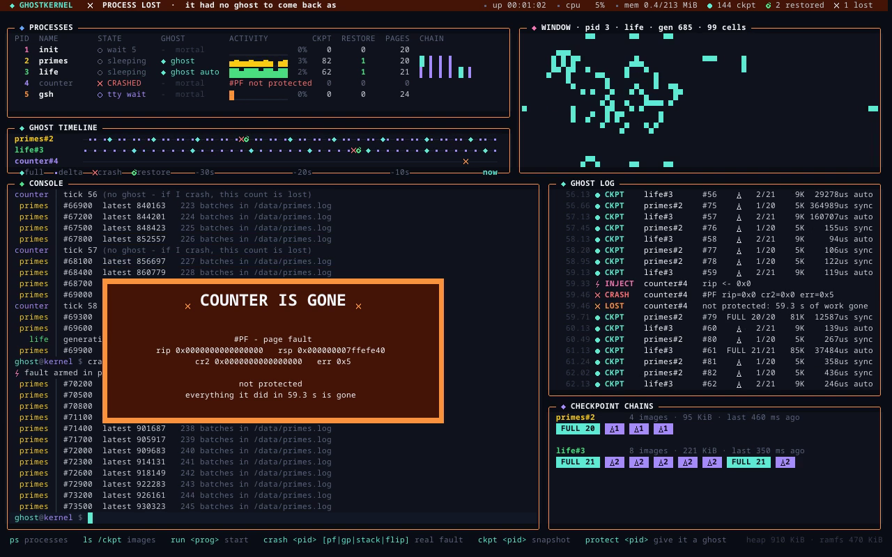
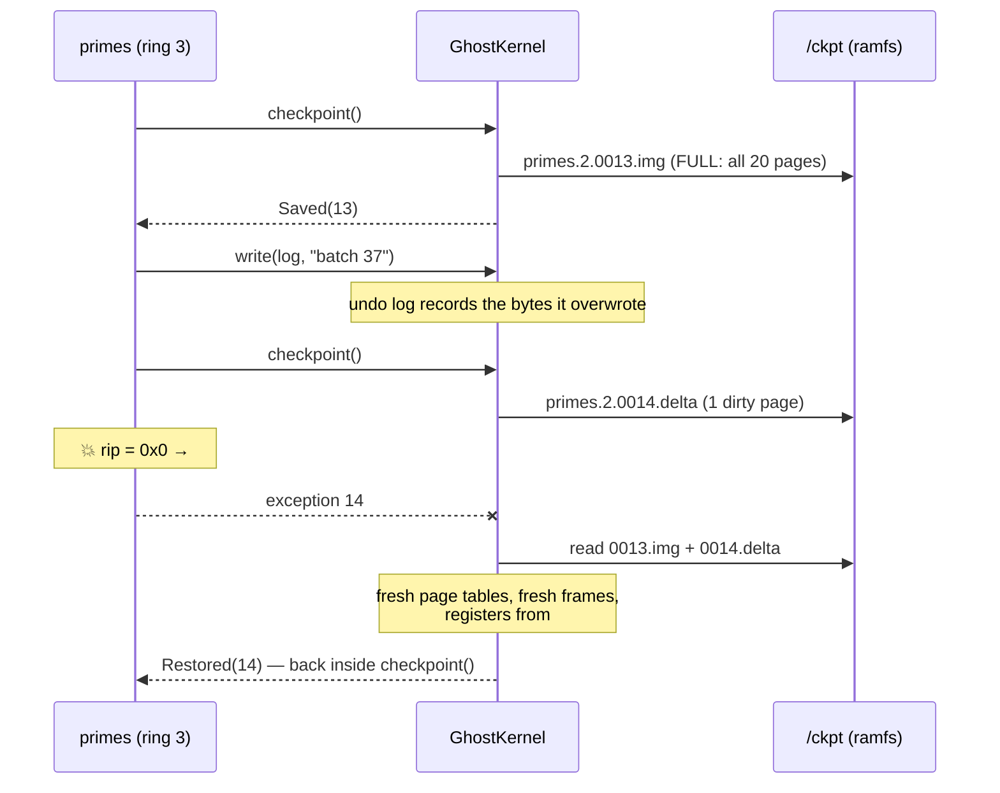

<div align="center">

# 👻 GhostKernel

### An x86-64 kernel in Rust whose processes come back from the dead.

Crash a running program. Watch the kernel rebuild it from a checkpoint, mid-computation,<br>
with its files rolled back to match. Then watch a program *without* a ghost die for good.

<br>


<br>



**▶ [Watch the full demo (2:43, with subtitles)](docs/demo.mp4)** · [subtitles (.srt)](docs/demo.srt)

</div>

---

## The problem

On a normal OS, a crash is final. One wild pointer at hour six of a six-hour job,
and the kernel kills the process: memory, registers, everything it computed, gone.
You start again from zero.

The usual fix lives in the application: hand-rolled save files, retry loops,
"resume from step N" flags. Every program reinvents it, and most of them don't
bother.

**GhostKernel moves that job into the kernel.** A process can be given a
*ghost*: a chain of checkpoints of its registers, memory and open files. When it
takes a fault in ring 3 (page fault, general protection, invalid opcode, divide
error), the kernel throws the dead address space away, rebuilds it from the
newest checkpoint, rolls back the file writes made since, and puts the process
back on the run queue. From the process's point of view, it just lost a few
hundred milliseconds.

## What you're looking at



The whole UI is drawn by the kernel itself, on a 1280×800 framebuffer, with no
BIOS text mode:

| Panel | What it shows |
|---|---|
| **Processes** | every process, its state, whether it has a ghost, live syscall activity, checkpoint and restore counts |
| **Ghost timeline** | the last ~40 seconds per process: ◆ full image · • dirty-page delta · ✖ crash · ↻ restore |
| **Window** | a shared canvas user programs can draw into (`life` runs Conway's Game of Life here) |
| **Console** | output of every process, tagged and coloured, plus the `gsh` shell prompt |
| **Ghost log** | every checkpoint, injection, crash, restore and loss, with sizes and timings |
| **Checkpoint chains** | the images each protected process could be restored from right now |

When something crashes, the header turns red, a banner shows the real CPU exception
(`#PF rip=0x0 cr2=0x0 err=0x5`), and then it turns green while an animated bar
rebuilds the process's pages. An unprotected process gets an orange banner instead:



## Quick start

```bash
# toolchain (rust-toolchain.toml pins nightly + the bare-metal target)
rustup show
# QEMU: brew install qemu  /  apt install qemu-system-x86
make run
```

That's it: `make` builds the user programs, embeds them into the kernel, wraps
the kernel as a multiboot image and boots it in QEMU. In the `gsh` shell:

```text
ghost@kernel $ ps                      # who's running, who has a ghost
ghost@kernel $ ls /ckpt                # the checkpoint images, as real files
ghost@kernel $ crash 2                 # corrupt primes' saved RIP -> real #PF
ghost@kernel $ crash 3 gp              # non-canonical RIP -> real #GP
ghost@kernel $ crash 4                 # counter has no ghost: lost for good
ghost@kernel $ run flaky det           # a deterministic bug -> crash-loop guard
ghost@kernel $ tail /data/primes.log 5 # every batch exactly once, in order
ghost@kernel $ protect 4 500           # give any process a ghost (auto every 500 ms)
```

## How it works

### One door into the kernel

Exceptions, timer and keyboard IRQs and `int 0x80` syscalls all enter through
the same assembly stub and leave the same 176-byte `TrapFrame` on the stack
([`arch/trap.rs`](kernel/src/arch/trap.rs)). That single decision makes
everything else simple:

- a **context switch** is "copy the frame into the old process, copy the new
  process's frame over it, `iretq`". No per-process kernel stacks, because the
  kernel never sleeps in the middle of a syscall. A blocking call rewinds
  `rip` by two bytes and re-executes `int 0x80` when the process wakes;
- a **checkpoint** is "that frame + the pages + the fd table";
- a **crash** is "a frame with `cs & 3 == 3` and an exception vector".

### The ghost engine ([`ghost/`](kernel/src/ghost/mod.rs))



**What a checkpoint holds.** Registers (the trap frame), every user page with its
PTE flags, and the file descriptor table (inode + offset). It's written as a real
file under `/ckpt` in a simple binary format ([`ghost/image.rs`](kernel/src/ghost/image.rs)),
so `ls /ckpt` shows exactly what the kernel can restore from.

**Incremental, using the CPU's own dirty bits.** After a full image, the kernel
clears the D bit in every user PTE and flushes the TLB. The next checkpoint copies
only pages the hardware marked dirty since. `primes` touches 1 page out of 20
between checkpoints, so most deltas are 5 KiB instead of 81 KiB. Every sixth
generation is a full image again, so chains stay short, and garbage collection
keeps exactly the images needed to restore any of the last three generations.

**Three ways to take one.**

| Trigger | Who | Notes |
|---|---|---|
| `checkpoint()` syscall | the process, at points it picks | works like `setjmp`: returns `Saved(n)` now and `Restored(n)` after a resurrection |
| timer | the kernel, every N ms | transparent; `life` never knows it happens |
| `ckpt <pid>` | anyone, from the shell | snapshots a parked process from its saved frame |

**Files roll back too.** Restoring memory alone isn't enough: `primes` appends a
line per batch, and if it crashed 40 lines after a checkpoint, a memory-only
restore would write those 40 lines twice. Every write a protected process makes is
logged with the bytes it overwrote ([`fs/undo.rs`](kernel/src/fs/undo.rs)); a
restore replays the log backwards, and falling back several generations replays
each generation's log in turn. The demo checks this live: after every
resurrection `primes` counts the lines in its log and compares them with its
in-memory counter.

**Crash loops don't loop.** A deterministic bug will crash again after every
restore. GhostKernel retries the newest checkpoint, then falls back one
generation per repeated failure, and gives up after three failed generations, or
after five crashes in ten seconds, whichever comes first (`run flaky det` shows
both).

**Fault injection is real.** `crash <pid> [pf|gp|stack|flip]` doesn't fake
anything. It corrupts the target's saved `rip` or `rsp`, so the next time it's
scheduled the CPU itself raises the exception in ring 3. `flaky` doesn't even
need that: it has a genuine wild write to address `0x10`.

### The rest of the kernel

| Pillar | Where | What's there |
|---|---|---|
| **Boot** | [`boot.rs`](kernel/src/boot.rs) | Multiboot header, 32-bit entry, identity-mapped page tables with 2 MiB pages, PAE + EFER.LME, far return into 64-bit code. No bootloader crate |
| **Interrupts** | [`arch/`](kernel/src/arch) | GDT with ring 0/3 segments + TSS (trap stack, double-fault IST), IDT with 49 vectors, remapped 8259 PIC, PIT at 100 Hz |
| **Virtual memory** | [`mm/`](kernel/src/mm) | free-list frame allocator from the multiboot memory map, 40 MiB kernel heap, a PML4 per process with the kernel half shared supervisor-only and user space at 1–2 GiB in 4 KiB pages |
| **Processes** | [`proc/`](kernel/src/proc) | ELF64 loader (W^X pages), preemptive round-robin with 30 ms slices, sleep, blocking keyboard reads, `wait`, an idle loop in ring 0 |
| **System calls** | [`syscall.rs`](kernel/src/syscall.rs) | 25 calls over `int 0x80`; every user pointer is checked against the caller's page tables first |
| **File system** | [`fs/`](kernel/src/fs) | in-memory inode filesystem with directories, fd tables with offsets, append/truncate, `/bin` holding the embedded user programs |
| **Drivers** | [`drivers/`](kernel/src/drivers) | 16550 serial (everything is mirrored there for tests), PCI config space, Bochs VGA framebuffer, PS/2 keyboard |
| **UI** | [`ui/`](kernel/src/ui) | cell-diffing renderer: compose the whole screen every 40 ms, repaint only changed cells. Box drawing, sparklines and icons are drawn procedurally |

### User space

Everything in `/bin` is a separate `no_std` Rust program linked at `0x4000_0000`,
using a ~350-line runtime ([`user/src`](user/src)):

| Program | Role in the demo |
|---|---|
| `init` | pid 1: starts the cast, protects `life`, respawns the shell |
| `gsh` | the shell: line editing, 19 commands, all of them plain syscalls |
| `primes` | long computation that checkpoints itself and proves its log is consistent after every restore |
| `life` | Game of Life in the window; checkpointed transparently by the timer |
| `counter` | the control group: no ghost, no second chances |
| `flaky` | a real bug: random (transient) or at a fixed step (`det`) |

## Tests

```bash
make test   # 7 in-kernel tests on the real allocator, page tables and fs
make e2e    # boots the VM, types into gsh, checks 13 promises on the serial log
```

The kernel tests cover frames, the filesystem, the undo log, the ELF loader,
**hardware dirty-bit tracking** (including the stale-TLB case), a full + delta
checkpoint with restore and generation fallback, and garbage collection. The
end-to-end test drives the real kernel through the whole demo: restore, log
consistency, `#GP` recovery, an unprotected loss, generation fallback, crash-loop
detection, no duplicate log lines, no kernel panic. Both run in CI.

## Recording the demo

`make demo` re-records [`docs/demo.mp4`](docs/demo.mp4) from scratch. QEMU starts
paused and headless, [`tools/record_demo.py`](tools/record_demo.py) types the
script into `gsh` over the QEMU monitor, grabs the screen 12 times a second, and
ffmpeg burns the subtitles into a caption bar under the screen, so they never cover
the dashboard.

## Honest limits

- **Checkpoints live in RAM.** They survive a process crash, not a reboot.
  Writing images to a disk is the obvious next step.
- **Console output can't be un-printed.** File writes roll back; text already on
  screen stays (the classic output-commit problem). Replayed work prints again.
- **Transient faults recover, deterministic bugs don't.** Restoring a program into
  the same state reruns the same bug; the crash-loop guard turns that into a clean
  failure instead of an infinite loop.
- **One CPU, no SMP, no SSE in user space** (everything is soft-float, so there's
  no FPU state to save).
- Timings in the log are measured under QEMU's software CPU; real hardware would
  be much faster.

## Layout

```text
kernel/            the kernel (no_std, x86_64-unknown-none)
  src/boot.rs        multiboot entry, 32 -> 64-bit switch
  src/arch/          GDT/TSS, IDT, trap stubs, PIC, PIT
  src/mm/            frames, heap, page tables
  src/proc/          processes, scheduler, ELF loader, faults
  src/ghost/         checkpoint images, restore, fault injection
  src/fs/            ramfs + undo log
  src/ui/            framebuffer dashboard
  src/selftest.rs    in-kernel tests
user/              ulib + the programs in /bin
tools/             QEMU driver, e2e test, demo recorder
docs/              demo video, GIF, screenshots
```

## Credits

Built by **[coolstack-coder](https://github.com/coolstack-coder)**. Philipp Oppermann's
[Writing an OS in Rust](https://os.phil-opp.com) was the starting reference;
GhostKernel deliberately takes its own path (its own multiboot boot code, no
bootloader or `x86_64` crate, a trap-frame-based scheduler) to keep every layer
visible. The font is Noto Sans Mono via
[`noto-sans-mono-bitmap`](https://crates.io/crates/noto-sans-mono-bitmap).

MIT licensed.
